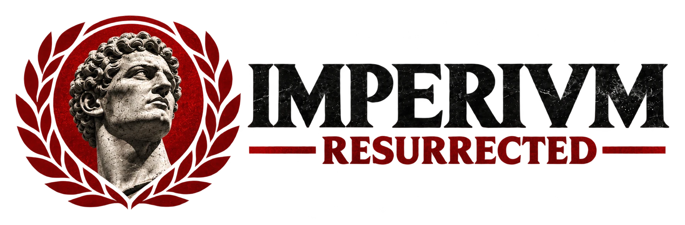

  

<a href="README.md">English</a> · <a href="README.es.md">Español</a> · <b>Italiano</b>

# Imperivm Resurrected

Mod non ufficiale per **Imperivm: Great Battles of Rome HD** (Steam). Dà al gioco ciò che gli serviva per restare vivo:
online senza aprire porte, mod con un clic, controlli personalizzabili e molte correzioni.

> **Stato:** versione 1.0. Provata in partite online a due giocatori; non ancora provata con più giocatori. Se qualcosa non funziona, vedi [Se qualcosa non funziona](#se-qualcosa-non-funziona).

## Cosa offre

- **Online tramite Steam**, senza aprire porte né usare VPN: stanze, inviti agli amici, chat e rientro in partita se qualcuno si disconnette.
- **Mod con un clic** dall'interno del gioco, con profili, versioni e dipendenze. Le mod sono pubblicate su
  [GameBanana](https://gamebanana.com/games/26069).
- **Controlli personalizzabili**: qualsiasi tasto del gioco e dei comandi, con preimpostazioni.
- **Schermo moderno**: Direct3D 11, risoluzioni attuali, finestra o schermo intero senza sfarfallii e l'overlay di Steam.
- **Audio moderno**, salvataggio automatico, un pannello delle prestazioni e correzioni per i crash del gioco originale.
- **Una segnalazione dei problemi** integrata nel gioco, con i dati privati nascosti.
- **Si aggiorna da solo**: il gioco ti avvisa quando c'è una nuova versione.

## Installazione

1. Scarica `imperivm-resurrected-setup-<versione>.exe` dall'[ultima release](https://github.com/THIONG/imperivm-resurrected/releases/latest) e aprilo.
   Se Windows dice «Windows ha protetto il PC», premi Ulteriori informazioni → Esegui comunque (l'installatore non è firmato).
2. Premi Installa. Trova il gioco di Steam, rimuove le modalità compatibilità di Windows, mette da parte i resti di altre mod e azzera la risoluzione salvata.
3. Avvia il gioco da Steam.

A mano: estrai lo zip della stessa release nella cartella del gioco, quella in cui si trova `gbr.exe` (in Steam: clic destro sul gioco → Gestisci → Sfoglia file locali).

Se aprendo il gioco non compare la cartella `Logs\imperivm`, la mod non si sta caricando. Togli la modalità compatibilità di `gbr.exe` (Proprietà → Compatibilità, anche in «Modifica impostazioni per tutti gli utenti»), sblocca `winmm.dll` (Proprietà → Annulla blocco) e controlla l'antivirus. Più dettagli nella [guida](https://www.imperivmresurrected.com/it/guide.html#not-loading).

Per disinstallare, riapri l'installatore e premi Disinstalla, oppure elimina `winmm.dll`, `steam_api.dll` e la cartella `imperivm-resurrected` dalla cartella del gioco. La mod non modifica nessun file del gioco.

Ti serve la tua copia del gioco su Steam. Questa mod non include nessun file del gioco.

## Se qualcosa non funziona

Nel menu principale del gioco, clicca sul cuore in basso a sinistra e poi su **Crea segnalazione**. Viene creato uno zip con i log
e i dati del tuo sistema, senza il tuo nome utente di Windows, gli ID di Steam e gli indirizzi IP. La mod non invia nulla: lo allegherai tu.

Poi [apri una segnalazione](https://github.com/THIONG/imperivm-resurrected/issues/new/choose) con lo zip, oppure chiedi su
[Discord](https://discord.gg/6kCatX3Zbc). I log si trovano in `Logs\imperivm\`, dentro la cartella del gioco.

## Creare mod

L'**SDK** è in [`sdk/`](sdk): guide, strumenti ed esempi per creare contenuti senza compilare nulla, in inglese
([inizia da qui](sdk/README.md)). Ogni release lo allega come zip.
Le mod finite si pubblicano su [GameBanana](https://gamebanana.com/games/26069).

## Sviluppo

Il codice della mod è in `src/` (C++ per Windows, 32 bit), i test in `tests/` e i controlli in `tools/`.
Come compilare, cosa verifica `tools\run-tests.bat` e come inviare una modifica: [CONTRIBUTING.md](CONTRIBUTING.md).
Per compilare la DLL serve l'SDK di Steamworks di Valve, che non è in questo repository.

Ogni release viene verificata da `.github/workflows/release.yml` (tag, hash, firma e contenuto dello zip). Puoi eseguire lo stesso
controllo su una release scaricata con `node tools/verify-release.js <cartella>`.

## Licenza

- **Codice** (`src/`, `tests/`, `tools/`): GPL-3.0-or-later con un'eccezione aggiuntiva per Steamworks. Vedi [LICENSE](LICENSE)
  e [ADDITIONAL-PERMISSION.md](ADDITIONAL-PERMISSION.md). Software di terze parti: [THIRD-PARTY-NOTICES.md](THIRD-PARTY-NOTICES.md).
  Crediti: [CREDITS.md](CREDITS.md).
- **SDK** (`sdk/`): MIT per il codice e CC BY-SA 4.0 per le guide. Vedi [sdk/LICENSE.md](sdk/LICENSE.md).
- **Immagini** (`assets/`): tutti i diritti riservati. Vedi [assets/LICENSE.md](assets/LICENSE.md).

---

Imperivm Resurrected è un progetto di appassionati. Non è affiliato né approvato da FX Interactive o Haemimont Games.
Imperivm e Great Battles of Rome sono marchi dei rispettivi proprietari.
